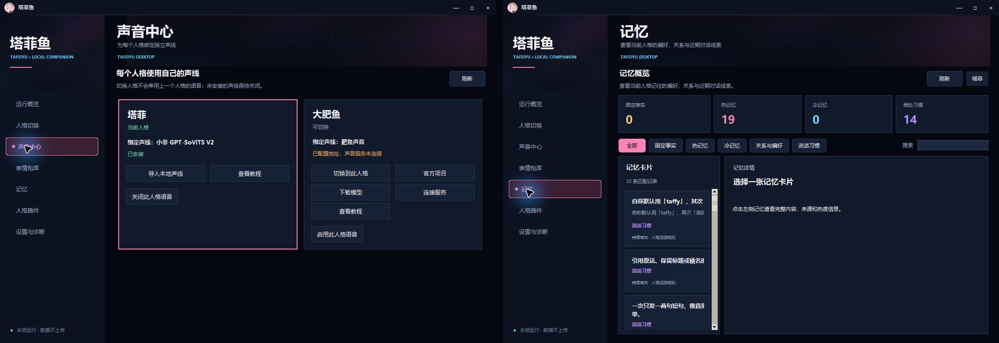
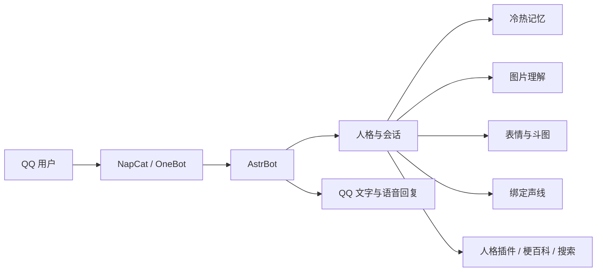

<div align="center">
  
  <h1>塔菲鱼 · tafeiyu</h1>
  <p><strong>把会聊天、会看图、会记事、会斗图、能换声线的 AI 陪聊，装进你的 QQ。</strong></p>
  <p>Windows 桌面客户端 · 本地优先 · 人格独立记忆与声线 · AstrBot + OneBot</p>

  [](#快速开始)
  [](docs/ARCHITECTURE.md)
  [](LICENSE)
  [](https://github.com/jiangxianyan/tafeiyu/stargazers)

  [功能亮点](#不只是文字回复) · [快速开始](#快速开始) · [文档](#文档地图) · [项目边界](#重要说明) · [下载 Releases](https://github.com/jiangxianyan/tafeiyu/releases/latest)
</div>



塔菲鱼不是另一个套着 Web 页面的聊天机器人。它是一个面向 Windows 的 QQ AI 陪聊控制中心：用可视化客户端管理模型、QQ 连接、人格、语音、记忆、图片和表情包，让不同角色真正拥有各自的声音、关系与长期上下文。

> **English TL;DR:** Taffy Fish is a Windows-first, local-persona AI companion client for QQ, featuring per-persona memory, vision, sticker battles, voice bindings, and safe prompt plugins.

## 为什么不只是“接入一个大模型”

普通 QQ Bot 往往能做到“收到消息，返回文字”。塔菲鱼继续往下做了几步：

- **角色不会串味**：每个人格拥有独立记忆、视觉形象、插件状态和语音绑定。
- **聊天不只靠上下文窗口**：冷热记忆会分层、冷却、按线索召回，可固定重要事实。
- **能看见你发的图**：私聊与群聊图片会先生成视觉描述，再交给角色自然回应。
- **不只会打字**：支持 GPT-SoVITS 本地声线和外部 HTTP 语音服务，私聊与群聊都可出声。
- **更像在群聊里生活**：会根据语境补表情包，也能和群友进行有限回合的斗图。
- **所有能力都装进客户端**：配置向导、人格切换、记忆卡片、声音中心、表情包库和人格插件都在主窗口内切换。

## 不只是文字回复

| 能力 | 当前实现 |
| --- | --- |
| 💬 QQ 陪聊 | AstrBot + OneBot，通过独立 QQ 号运行，支持私聊、群聊、名单和历史压缩 |
| 🎭 多人格 | 默认塔菲与大肥鱼，可导入 Markdown 人格；记忆、形象、声线和插件互相隔离 |
| 🧠 长期记忆 | 卡片化记忆中心展示固定事实、热记忆、冷记忆、关系线索与相处习惯，可按关键词筛选并查看原文 |
| 👀 图片理解 | 独立视觉模型描述图片，支持私聊识图和主人群聊图片直达回复 |
| 🎙 角色语音 | 人格切换时同步切换声线；本地 GPT-SoVITS 与外部服务均支持，语音请求和自动语音可配置 |
| 😺 表情与斗图 | 语境匹配补表情、自动标签、可视化标签编辑、有限回合斗图 |
| 🧩 人格插件 | 按人格独立启停的声明式提示词扩展，不执行任意 Python 或可执行文件 |
| 📚 梗百科 | 本地词库，命中时只向当前人格注入一条相关词条，不污染整段上下文 |
| 🔎 安全搜索 | 显式联网搜索，带隐私清洗、域名策略、私网访问与下载内容防护 |
| 🖥 一键客户端 | 首次配置向导、运行状态、服务启停、二维码登录、诊断与自动守护 |

详细能力和实现说明见 [docs/FEATURES.md](docs/FEATURES.md)。

## 为什么它适合“长期养一个角色”

### 声音跟着角色走

切换人格时，塔菲鱼会同时切换该人格绑定的声线，不会因为缓存或配置残留让大肥鱼突然发出塔菲的声音。语音资源未随项目分发，用户可以接入自己有权使用的 GPT-SoVITS 模型和参考音频。

### 记忆不是一条无限增长的聊天记录

重要事实可以被固定；近期提及会保持高温；长时间未用的内容会冷却，但不会消失。需要时，系统会通过当前话题或关系线索把相关记忆重新带回。不同人格不会共享同一套关系记忆。

### 图片、表情和文字走同一条人格链路

看到图片后，视觉描述会作为当前人格的消息输入；表情包也会根据回复情绪和标签选择。角色看到、记住和表达的仍然是同一个人格，而不是几个互不相干的机器人拼接。

### 本地数据和密钥不进入 Git

API Key、QQ 会话、聊天数据库、日志、声线权重和参考音频都被排除在公开仓库之外。记忆检索与召回在本地完成。

## 快速开始

### 使用 Release 便携包

1. 打开 [全部 Releases](https://github.com/jiangxianyan/tafeiyu/releases)。
2. 选择带有 `tafeiyu-offline-part*.zip` 的完整运行时分卷。只有 `tafeiyu-source-part*.zip` 的 Release 是源码包，不能直接运行桌面客户端。
3. 按当前 Release 和 `SHA256SUMS.json` 列出全部分卷下载，核对后解压到同一目录；不要只解压第一个分卷。
4. 预留约 15 GB 以上磁盘空间，解压到可写目录，建议使用 `D:\TafeiYu` 这类简单 ASCII 路径，不建议放入 `C:\Program Files`。
5. 如果包内有 Python 安装器，直接双击 `安装塔菲鱼.bat`；否则先安装 Python 3.12，再运行 `安装塔菲鱼.bat` 安装启动器依赖并启动。缺少正确的 Python 版本时，脚本会打开官方下载页。
6. 按五步配置向导填写模型、机器人 QQ、主人 QQ、群聊名单，并可选导入自己的声线。
7. 扫码登录 QQ，等待 AstrBot、NapCat 和本地语音服务全部在线。

完整运行包内的 `首次运行说明.txt` 会提供随机生成的本地 AstrBot
管理页初始密码；首次登录后应立即修改。源码包不包含开发机的密码或 JWT。

首次运行需要准备：

- Windows 10/11；
- Python 3.12（如果下载包中没有 `runtime\python-installer.exe`；暂不支持 Python 3.13）；
- 一个 OpenAI 兼容模型服务或 API Key；
- 一个独立的机器人 QQ 号；
- 可选：你有权使用的 GPT-SoVITS 权重与参考音频。

提供完整运行时分卷的稳定版本可在
[v0.1.2](https://github.com/jiangxianyan/tafeiyu/releases/tag/v0.1.2)
查看。源码 Release 与完整离线 Release 会使用不同文件名；下载前请先确认
Release 说明。

### 数据保存在哪里

聊天配置、记忆、人格、插件状态和本地语音配置默认保存在解压目录下的
`astrbot\data\`；QQ 登录状态保存在 NapCat/Tencent Files 目录。项目不会把
这些数据同步到开发者服务器。

但“本地保存”不等于所有处理都在本地：聊天文本会发送给配置的大模型 API，
图片会发送给视觉模型，联网搜索会把查询发送给搜索引擎，使用外部语音服务时
待朗读文本会发送给对应服务。QQ 消息本身仍经过腾讯服务器。

### 从源码运行

```powershell
git clone https://github.com/jiangxianyan/tafeiyu.git
cd tafeiyu
python -m pip install -r requirements-launcher.txt
```

源码模式还需要自行准备 AstrBot、NapCat 和可选 GPT-SoVITS 运行环境。
完成依赖安装后运行 `启动塔菲.bat`，按配置向导初始化。详细环境与运维要求见
[docs/OPERATIONS.md](docs/OPERATIONS.md)。

## 运行结构



客户端负责启动、配置和可视化；AstrBot 负责消息处理、模型调用与插件链；NapCat 负责 QQ 与 OneBot 桥接；GPT-SoVITS 作为本地可选语音服务。

## 适合谁

- 想给自己的 QQ AI 做完整桌面客户端，而不是只跑一个脚本的人；
- 想尝试独立人格、独立记忆、独立声音和多角色扩展的人；
- 想研究本地优先 AI 陪聊架构、冷热记忆或人格插件安全边界的人；
- 想用公开源码搭一个非商业个人项目，同时保留合规与素材声明的开发者。

## 重要说明

塔菲鱼是**非官方粉丝项目**，与永雏塔菲、其官方团队及相关权利方没有隶属、授权或背书关系。人格与说话方式的一部分参考了 MIT 许可的 [`ace-taffy-skill`](https://github.com/ly-xxx/ace-taffy-skill)。

本项目**不包含**角色语音权重、参考音频、生成语音样本、角色表情包或其他未经确认可再分发的第三方素材。公开可访问不等于允许再分发；请只使用自己有权使用的资源，并遵守平台规则、人格权、声音权和著作权。

完整声明见 [NOTICE.md](NOTICE.md)，第三方许可见 [THIRD_PARTY_LICENSES.md](THIRD_PARTY_LICENSES.md)。

## 文档地图

| 文档 | 内容 |
| --- | --- |
| [功能全景](docs/FEATURES.md) | 当前完整功能、运行边界与组件关系 |
| [架构说明](docs/ARCHITECTURE.md) | 运行时、插件链和关键设计 |
| [运维指南](docs/OPERATIONS.md) | 启动、停止、验证与故障处理 |
| [语音包](docs/VOICE_PACKS.md) | GPT-SoVITS、外部服务、授权和端口问题 |
| [图片与形象](docs/VISION_AND_VISUALS.md) | 私聊识图、群聊图片和人格视觉卡 |
| [表情与斗图](docs/STICKERS.md) | 标签、同步、概率和回合上限 |
| [人格插件](docs/PERSONA_PLUGINS.md) | `.tafeiplugin` 格式、安全限制和示例 |
| [梗百科](docs/MEMEWIKI.md) | 本地词库、匹配和独立数据下载 |

## 项目状态

项目仍在快速迭代，当前以 Windows + QQ + AstrBot 为主。接口、配置结构和界面可能继续调整。遇到问题请通过 [Issues](https://github.com/jiangxianyan/tafeiyu/issues) 提交，并附上脱敏后的错误日志；不要在 Issue 中公开 API Key、QQ 登录信息、聊天记录或声线文件。

## 交流与反馈

QQ 交流群：**296334261**

群内用于安装排查、功能讨论、人格与插件交流，以及合法声线来源的互相交流。群内不托管或分发未经授权的模型权重、参考音频、角色素材或聊天数据。

## License

项目源码采用 [GNU AGPL-3.0](LICENSE) 许可。分发修改版或通过网络提供修改后的服务时，请遵守 AGPL 的源代码开放要求。

如果塔菲鱼让你想做一个“不只是回文字”的 QQ AI 陪聊，欢迎点一个 **Star**，也欢迎把它改成属于你自己的角色客户端。
